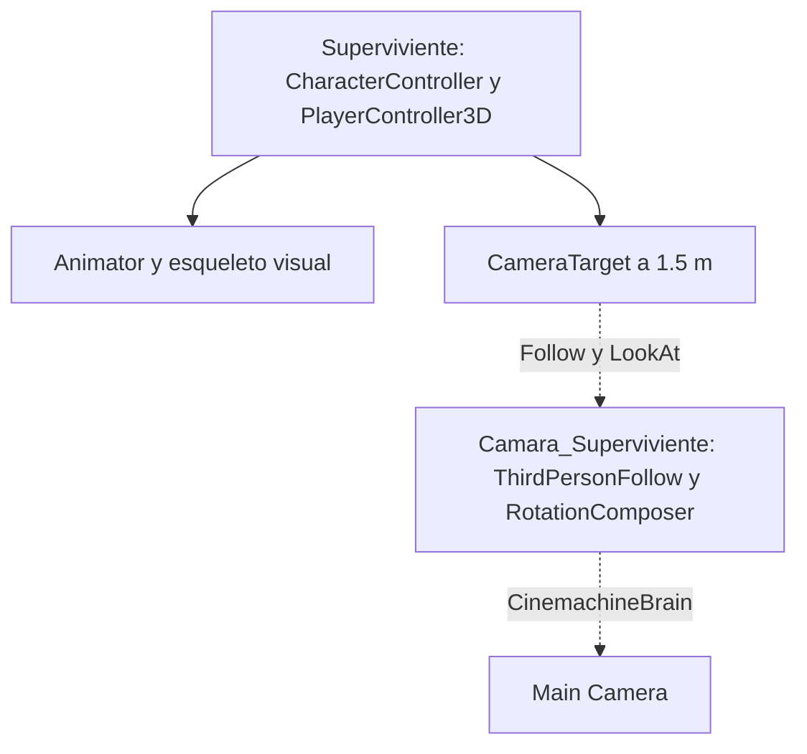

# Journal 3D Transition - Semana 9

Proyecto: Survival. La casa y el bosque se mantienen en SampleScene.

## Tres diferencias técnicas entre 2D y 3D

1. El desplazamiento usa X/Z y la altura usa Y. La perspectiva puede superponer objetos que están lejos en profundidad. Verificamos las piezas desde varios ángulos.
2. Una cámara 3D tiene posición, orientación y volumen cerca de obstáculos. El seguimiento necesita un pivote alto, suavizado y protección contra paredes.
3. El personaje necesita una cápsula de colisión y control explícito de gravedad. CharacterController.Move desplaza al jugador, pero no integra por sí mismo gravedad ni fuerzas.

## Controlador propio

`Assets/Scripts/PlayerController3D.cs` sustituye al controlador de movimiento de Starter Assets en el superviviente. Conservamos de Starter Assets las acciones del Input System, las animaciones humanoides y los sonidos. No presentamos esos recursos como código o arte original.

| Parámetro | Valor |
| --- | --- |
| Caminar | 2.1 m/s |
| Correr | 4.4 m/s |
| Salto | 1.2 m |
| Gravedad | -15 m/s² |
| Aceleración horizontal | 10 m/s² |
| Altura CharacterController | 1.8 m |
| Centro Y | 0.92 m |
| Radio | 0.27 m |
| Objetivo de cámara Y | 1.5 m |

### Por qué usamos Time.deltaTime

Move recibe metros de desplazamiento. Multiplicamos metros/segundo por segundos/fotograma para obtener metros/fotograma. Así, la velocidad no depende de la tasa de imágenes.

### Salto y gravedad

La velocidad inicial es `sqrt(jumpHeight * -2 * gravity)`. Con 1.2 m y gravedad -15 resulta 6 m/s. La gravedad se suma a la velocidad vertical en cada Update y el desplazamiento final se multiplica por deltaTime. Al tocar suelo fijamos una pequeña velocidad negativa para mantener el contacto.

Si comparamos la misma altura con gravedad -9.81 y -20, la velocidad inicial pasa de unos 4.85 a 6.93 m/s. La gravedad más intensa produce un salto más rápido y menos flotante. Es una comparación física calculada; no es una encuesta realizada a jugadores.

### Movimiento y coordenadas

El código transforma el vector de entrada X/Z por el ángulo horizontal de la cámara. W avanza hacia el fondo de la vista, y el personaje gira suavemente hacia la dirección de movimiento. Es una variante de tercera persona de la fórmula relativa `transform.right * x + transform.forward * z` de clase.

## Jerarquía y seguimiento

La Main Camera es un objeto independiente. Cinemachine sustituye el rig anidado de la semana 9 por reglas de seguimiento de la semana 10. Conserva el objetivo alto y la separación del modelo visual.

**Si se exige el diagrama a mano, copia esta jerarquía en tu cuaderno y adjunta la fotografía. Este archivo contiene un diagrama digital.**

## Terreno y orientación

Hay una capa de césped y una de tierra. El sendero conecta la zona inicial, la entrada de la casa y una subida hacia los cerros. La hierba se retira del sendero. El borde del terreno se eleva como límite natural, conservando el centro de construcción plano. Los árboles mantienen su altura sobre el relieve.

- Suelo: tag Ground.
- Colisiones de arquitectura y vegetación: tag Obstacle.
- Zona de cámara: tag Interactable.
- Personaje: tag Player.

## Misión de orientación

Abre `Assets/Practicas_S09_S10/Escenas/S09_Orientacion.unity`. Selecciona Artifact y usa la herramienta Mover (W) en Scene. Los cinco Target tienen MeshRenderer desactivado. Trabaja en pareja: otra persona dicta las coordenadas sin señalar los objetos. Verifica la posición desde más de una vista.

| Target | X | Y | Z |
| --- | --- | --- | --- |
| 1 | 3 | 1 | 2 |
| 2 | -4 | 2 | 3 |
| 3 | 1 | 4 | -3 |
| 4 | -2 | 1 | -5 |
| 5 | 5 | 3 | -1 |

## Dev Kata S9: El Laberinto Imposible

Abre `S09_Laberinto_Imposible.unity`. Los tramos de cubos se superponen en la proyección ortográfica, aunque uno está separado en profundidad. Pulsa Play y P para revelar la profundidad desde otro ángulo; P vuelve a la vista inicial. Es un ejercicio de percepción espacial, no una afirmación de que exista una conexión física imposible.

Evidencias: `Evidencias/S09_Laberinto_Ortografico.png` y `Evidencias/S09_Laberinto_Profundidad.png`.

## Prueba entre compañeros: pendiente

No se ha realizado un playtest humano. Completar la ficha Playtest_Pendiente.md después de que otra persona juegue tres minutos, sin indicaciones. Las comprobaciones automáticas se documentan por separado.
